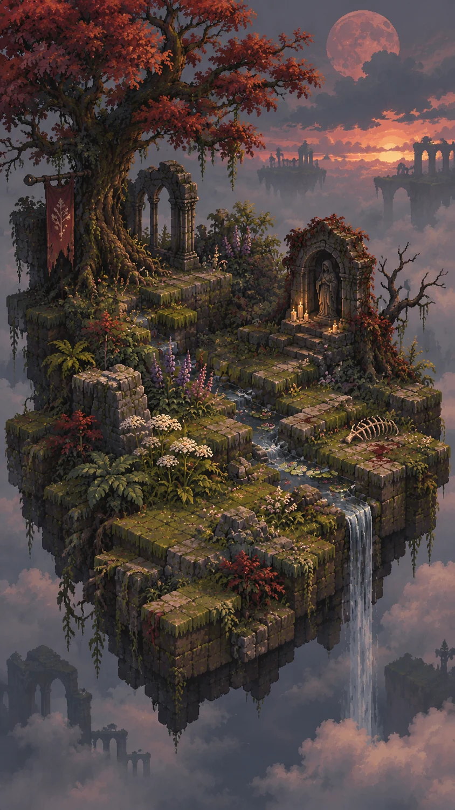
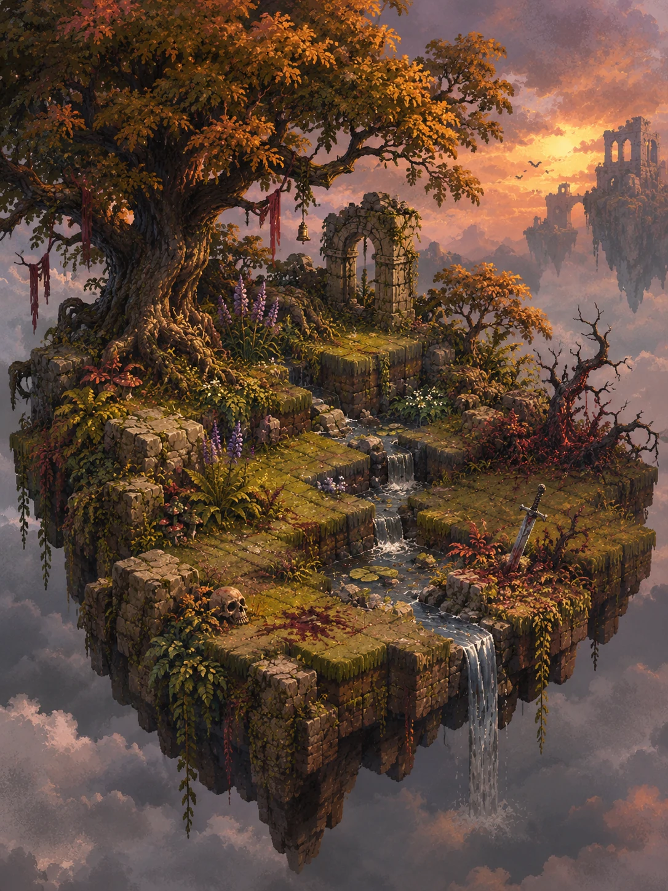
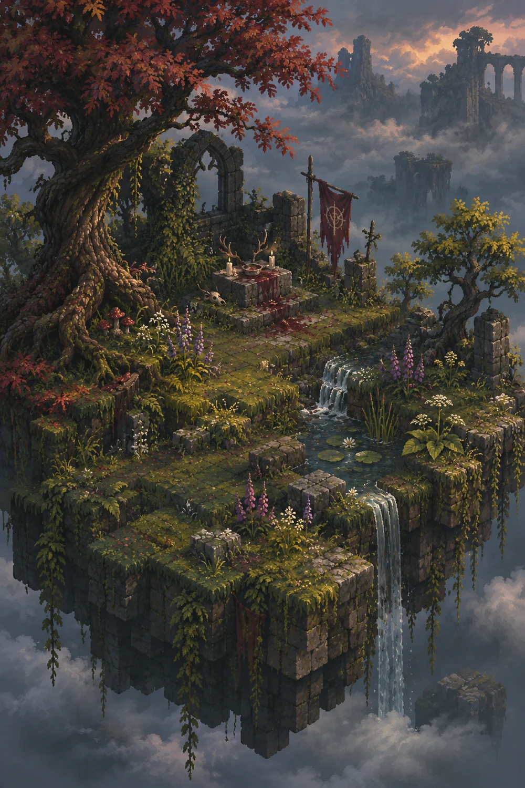
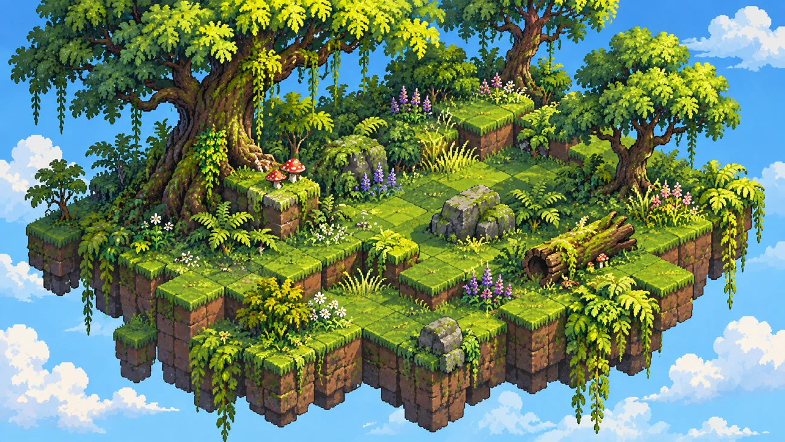
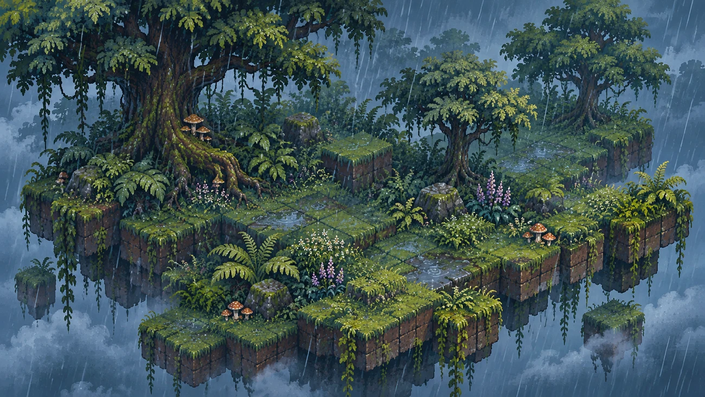
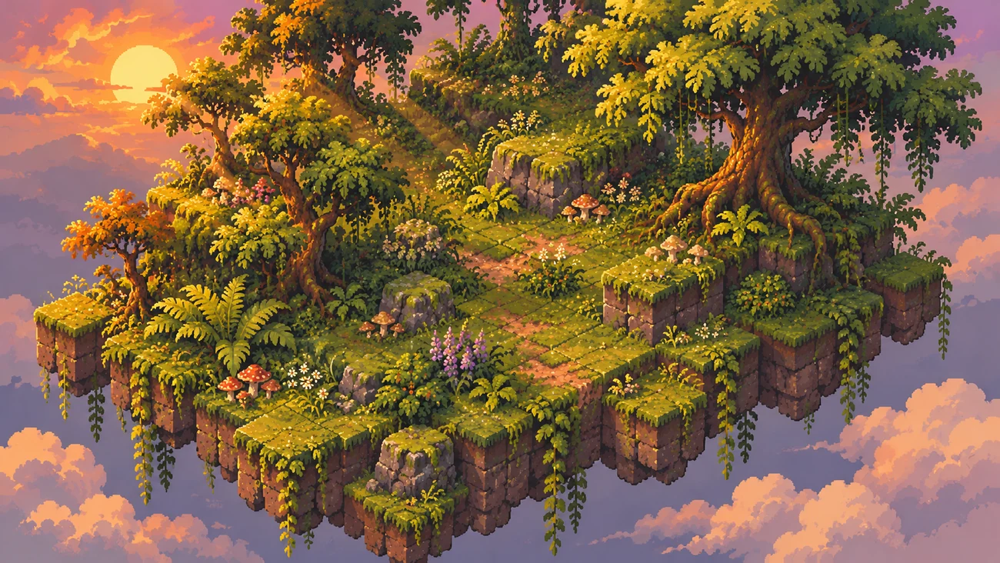

# MeetingIdle — Visual Direction Gallery

> **Status:** exploratory reference concepts, not finalized game assets  
> **Updated:** 2026-11-10  
> The floating wild-forest island is the intended subject, **not a cultivated farm**. These are image-generation art studies, not playable renders or tested asset sheets.

This gallery preserves two sets discussed during the visual-direction exploration. The block-based 2.5D floating-island composition remains a possible gameplay presentation; **none of these images constitutes an approved implementation style**.

## Set A — Dark fantasy / grimdark wild garden (currently liked)

A more somber and sometimes gore-inflected forest aesthetic inspired by the atmosphere of dark fantasy RPGs. Gnarled trees, tangled roots, overgrown stone and ruins, muted vegetation, blood-red foliage, decay, and moody skies. The world still needs to look like somewhere nature could reclaim and the player could influence.

**A1 · Red moon and shrine**

**A2 · Fallen garden**

**A3 · Ancient shrine / mist**

**Feedback so far:** The user likes the overall art language in this set. However, the exact degree of gore, prevalence of ruins/stone, and lighting style are *not* yet decided; the game should retain its wild-garden identity.

## Set B — Earlier first tile-based illustration trial (retain as reference)

These are the first three landscape-format game-scene attempts from the iteration where we emphasized visible Minecraft Skyblock-like earth blocks and the same island under different weather/light. The feedback at the time was: **"The first images are still too close to illustrated scenes, even though the blocks are more visible."** Save these because the **terrain and vegetation interplay** remains useful to compare with future studies.

**B1 · Sunny**

**B2 · Rainy**

**B3 · Golden hour**

## Shared constraints and design goals

- One **connected** landmass in the air; visibly constructed from terrain blocks in an elevated 2.5D perspective.
- A living, **wild forest-like place**, not formal crop beds, fences, or rows of managed flowers.
- Vegetation should be **lush and dense** enough to be attractive as a passive display / phone wallpaper while allowing the player to read patches and gradual changes.
- No permanent HUD, resource tables, or clickable card-style tile presentation; the world itself should fill the frame.
- The garden's look must change via ecology and player intervention, including changes the player may *not* like.
- **Original game art and discrete editable tiles/plant assets** will be needed for implementation. These composites are inspirational concept images, not source-ready sprites.

## Next visual questions

1. How far should the eventual game go toward **grimdark** vs. retaining some cozy sunlight and softness?
2. How much ruined architecture, bone, blood, or gore is appropriate on a naturally growing island?
3. What pixel detail level remains beautiful **and** readable on a phone?
4. Can we reproduce the chosen art language through **reusable game sprites and tiles** rather than uneditable illustrations?
5. How would the island look **before vs. after** wilderness takes over, at the same camera angle?

See [game-design.md](game-design.md) for the wider hybrid nature/cultivation gameplay concept.
