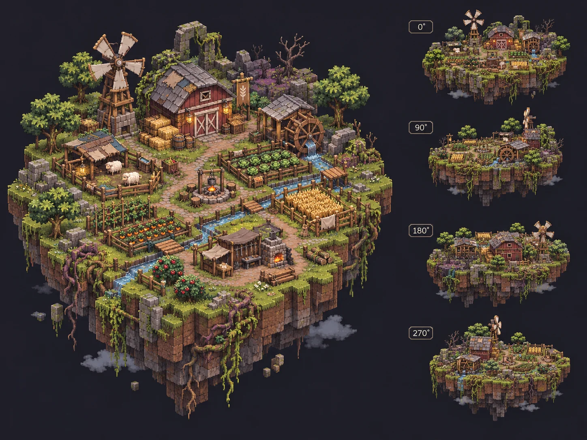

# Survival Farming — First playable experiment

Working title: **Hearthroot**. This is the gameplay-first interpretation of [Issue #2](https://github.com/ersoykadir/MeetingIdle/issues/2), not a permanent rejection of the original [wild garden direction](game-design.md).

## Core premise

Start with five settlers on a floating island. Plant useful species, let crops harvest automatically, and feed each settler **2 food every game-day, after harvest**. Initially that means 10 food/day. Grow production with Seed improvements and welcome more settlers when food reserves and hope support them. Shortages reduce hope, but never cause an immediate game over.

## Implemented

- Connected, irregular **104-tile** floating terrain with simple trees, wild thickets, farmland, and a cottage.
- Procedurally drawn, orthographic-style **2.5D** scene with **four horizontal 90-degree viewing angles**. This is not yet a true 3D renderer.
- Crops: **grain** (5 food in about 2 days), **roots** (8 food in about 3 days; tolerate frost better), and **berries** (11 food in about 4 days).
- Automatic crop harvest and regrowth; meadow planting, thicket clearing, and in-world tile inspection.
- Sunny weather, rain, wind, and frost. Rain helps growth and natural spread; frost slows most crops; wild thickets can encroach on crops and reduce yield.
- Local saves and capped offline simulation (up to 10 game-days).
- An accelerated game clock of **16.5 real seconds per game-day**, meant for rapid testing, not the final intended idle pacing.
- Minimal overlay UI for food, hope, day, settlers, daily meals and pantry supply, with an expandable five-day forecast. Mouse/touch controls, including horizontal drag rotation.

## Art direction

The image is a **reference concept**, not a screenshot or tileset. Our goal is rich, cozy-dark pixel-art with detailed vegetation, buildings, and a real **3D world rendered through a fixed-tilt orthographic camera**. The current game canvas is deliberately temporary and simpler.

## Controls

Plant using the Grain, Roots, or Berries tools. Clear wild vegetation or crops with Clear, and inspect the selected tile with Inspect. Drag horizontally or use the rotation arrows to view the island from other sides. The Help button describes the rules.

## Important questions to test

1. Do daily meals and conditional settlement growth create useful decisions without excessive pressure for an idle game?
2. Should wild growth offer **benefits** (soil, resilience, pollination) as well as obstacles?
3. Should we have a visible weather forecast and protective interventions?
4. Are shortages too forgiving or too punishing?
5. Is the farming settlement visually compelling enough to keep on a phone screen?
6. Can we create the approved art quality with reusable 3D assets and crisp pixel rendering, rather than static illustrations?

## Testing and limitations

The Node simulation suite at [tests/survival-sim.cjs](../tests/survival-sim.cjs) covers daily meals, harvest order, conditional arrivals, forecast accuracy, shortfalls, save migration, catch-up, Seed improvements, planting, zoom, rotation and a renderer call using a stubbed canvas. A 120-day run checks food accounting every day. Chromium checks at 320×568, 390×844 and 1024×768 verify forecast layout, the improvement panel, zoom, rotation and purchasing, with no runtime exceptions. Individual citizen artwork, production buildings, morale events, long-term seasons, meaningful ecological benefits, and polished 3D art are future work.

The original [Understory wild garden](../archive/understory-v0.2.html) remains playable for comparison.

## Prototype readability update

- Render the scene at **at least the display's CSS pixel resolution** rather than rendering tiny and scaling up on high-density phones.
- Strengthen terrain face edges, crop rows and distinct tree/thicket silhouettes so tiles can be recognized during prototyping.
- The day-cycle progress indicator now sits in the bottom control stack **above**, not behind, the tool dock.
- The five-settler ration mission defaults to a compact badge and expands/collapses on tap, saving that preference locally.
- Phone (390×844) and desktop (1024×768) layouts and mission/rotation interactions were smoke-tested in Chromium. This remains placeholder art, not the final 3D pixel-art implementation.

## Camera zoom (prototype update)

- Click/tap **−** or **+** in the bottom camera controls to zoom between **60% and 225%**.
- Click the percentage readout to reset to **100%**.
- Desktop: use the **mouse wheel** over the island, or the **+ / − / 0** keyboard shortcuts.
- Mobile: use **two-finger pinch**. A single-finger horizontal swipe continues to rotate the island by 90°.
- Zoom remains centered on the island. The chosen zoom level is saved separately in local browser storage and is preserved across rotation and resizing; it does not reset game progress.
- The help dialog now scrolls correctly on very short phone displays.
- Verified with simulation tests and Chromium browser checks at **320×568, 390×844, and 1024×768**, including zoom limits and pinch gesture handling.

## Idle progression iteration (November 11, 2026)

An earlier iteration used a 55-food target that rose by 12 every five days. **The daily population model below supersedes that quota system.**

Harvesting now produces **Seeds**, an investment currency earned alongside food (2 for grain/roots, 3 for berries, plus upgrades). A small Seed Shed UI makes four improvements available: **Living soil** (+25% food per harvest per level), **Water channels** (+20% growth speed per level), **Seed baskets** (+1 seed per harvest per level), and a one-time **Glasshouse** (protects non-root crops from frost). Prices increase by level; the goal is a `harvest → upgrade → harvest faster → afford more` loop. Seeds and levels are saved locally and preserved by migration to the daily food model.

This is a first pass for testing the *feeling of progression*. Final balancing, visual representations of infrastructure, new unlockable crops, and nature's positive ecological contributions remain open.

## Daily population model (November 11, 2026)

Each completed game-day grows and harvests crops first, then feeds the current population. Five initial settlers eat 10 food/day (2 each). The initial pantry is still 12 food, so the starter fields, further planting and early Seed investments matter. All food accounting goes through the same simulation in active play, offline catch-up and forecast copies.

**No five-day bill:** the five-day food requirement is `settlers × 2 × 5`, a forecast of ordinary daily meals. Neither a settlement review nor an arrival deducts food.

**Settlement growth:** after each five completed days (first review as day 6 begins), exactly one settler may arrive when the entire period had no shortfalls, hope after dinner is at least 70, and remaining food covers five days for the new population. For the first arrival that is 60 food stored after the fifth meal. The new settler eats from the following day. A failed check postpones growth to the next five-day review; there is no ever-rising unrelated quota.

**Transparent setbacks:** every day consumes the available food up to the daily need. Missing food costs `ceil(15 × shortfall / daily need)` hope, bounded below by 5. A fully fed day restores 1 hope, bounded above by 100. Food stays nonnegative; shortfalls never create future debt, kill settlers, reduce crop yields or erase Seed upgrades. For example, feeding 7 of the required 10 food loses 5 hope; feeding none loses 15. A shortfall also postpones arrival for that review period.

**Readouts:** the compact badge shows population, food/day and days of stored supply. The expanded panel shows remaining food, the next five days' meals, projected harvests, ending stock, the first shortage day and cumulative missing food, the last dusk's harvest/meal ledger, and the next arrival conditions. Stored supply means `pantry / daily need`, excluding future harvests. Forecasts hold population and player planting/clearing decisions fixed, use the same deterministic weather and growth rules, and explicitly exclude conditional arrivals. A later harvest cannot erase an earlier predicted missed meal.

**Save compatibility:** storage keeps its existing `meetingidle.hearthroot.v1` key, with payload version 2. Both pre-Seed and quota-era version-1 saves migrate to five settlers while retaining resources, map, upgrades, hope, day and rotation. Zoom and panel preferences keep their separate keys. Migration restarts the daily timer and a fresh five-day review period to avoid retroactive daily charges or arrivals based on unobserved meals under the old rules; it carries no food debt. Version-2 saves preserve population, current review-period shortfalls and the last daily report, and simulate at most ten elapsed days on reload or after a suspended tab resumes.

**Validation:** automated cases verify no extra deduction at five-day boundaries, harvest-before-meals with an empty pantry, exact arrival thresholds, proportional shortages, hope recovery, forecast agreement over multiple weather windows, 120 days of harvest/meal accounting and Seed reinvestment, old/new save round trips, bounded offline simulation and camera/UI controls. Balance remains a prototype tuning question, especially for extensive free planting and late-game food surpluses.
